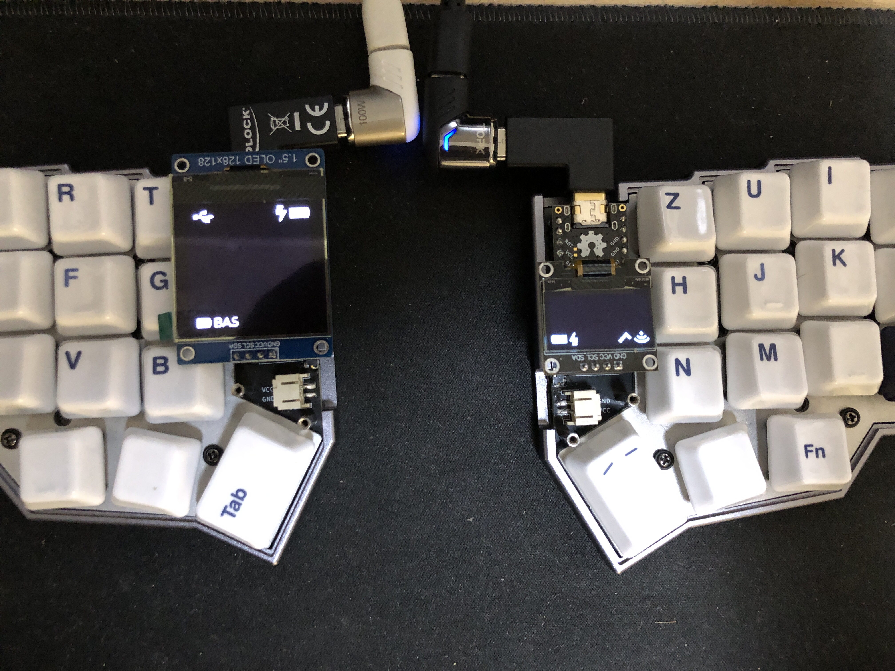

# Oled Adapter
This module is an adapter for 128x32, 128x64 and 128x128 OLED screens, to be
used on keyboards with ZMK without having to modify the shields of the
keyboards.

Compatible with all boards with pro micro and seeeduino xiao BLE pinout, like
the Nice!Nano, Puchi, clones and others.

Shields supported:
- oled_adapter_pro_micro_128x32
- oled_adapter_pro_micro_128x64
- oled_adapter_pro_micro_128x128
- oled_adapter_seeeduino_xiao_ble_128x32
- oled_adapter_seeeduino_xiao_ble_128x64
- oled_adapter_seeeduino_xiao_ble_128x128

[](https://github.com/mctechnology17/zmk-config)
[](https://github.com/mctechnology17/zmk-config)

# Versions, branches and tags

All my ZMK projects follow the same rules. The idea is that every project can be paired with ZMK in its different versions (v0.3, v0.4, ...), so you always know which branch or tag fits the ZMK version you use.

What to write as `revision:` in your `west.yml`:

| You want | `revision:` |
|---|---|
| The latest stable version | `main` |
| Stay on ZMK v0.3 and keep receiving fixes | `zmk-v0.3` |
| A fixed version that never changes | a tag, for example `v0.0.3` |

Branches:

- `main`: the stable version. It follows the newest ZMK version that the project supports.
- `zmk-v0.3`: maintenance for ZMK v0.3. It only receives fixes, never new features. When the project moves to a newer ZMK, the next branch is created the same way (`zmk-v0.4`, ...).
- `dev`: development. It can be broken at any time, do not use it for your keyboard.

Tags:

- `v0.0.3`: the common starting point of all my ZMK projects (Nov 18, 2026), tested with ZMK v0.3.
- `v0.0.4`, `v0.0.5`, ...: new versions, released from `main`. `v0.0.4` is planned as the update to the newest ZMK.
- `v0.0.3.1`, `v0.0.3.2`, ...: fixes for the ZMK v0.3 line, released from `zmk-v0.3` (`v0.0.3.1-fix` while a fix is still being tested).

Every release says which ZMK version it was tested with. The full list of changes is in [CHANGELOG.txt](CHANGELOG.txt).

# Usage
The following commands demonstrate how to overwrite the default 128x32 screen
with different screen sizes for various setups as an example:

- **Overwrite the left screen from 128x32 to 128x128:**
  ```bash
  west build -b nice_nano_v2 -- -DSHIELD="corne_left oled_adapter_pro_micro_128x128"
  ```

- **Overwrite the right screen from 128x32 to 128x64:**
  ```bash
  west build -b puchi_ble_v1 -- -DSHIELD="corne_right oled_adapter_pro_micro_128x64"
  ```

- **Using the Xiao as a dongle with the Corne, replacing the screen with 128x128:**
  ```bash
  # This example is from a dongle previously configured using a corne
  west build -b seeeduino_xiao_ble -- -DSHIELD="corne_dongle_xiao dongle_display oled_adapter_seeeduino_xiao_ble_128x128"
  ```

# Configuration
To use this module, first add it to your `config/west.yml` by adding a new
entry to `remotes` and `projects`:

```yaml
manifest:
  remotes:
    - name: zmkfirmware
      url-base: https://github.com/zmkfirmware
    - name: mctechnology17
      url-base: https://github.com/mctechnology17
  projects:
    - name: zmk
      remote: zmkfirmware
      revision: main
      import: app/west.yml
    - name: zmk-oled-adapter
      remote: mctechnology17
      revision: main
  self:
    path: config
```

Now simply indicate in the board and the shield in the `build.yaml` file:

```yaml
---
include:
  - board: nice_nano_v2
    shield: corne_left oled_adapter_pro_micro_128x128
  - board: puchi_ble_v1
    shield: corne_right oled_adapter_pro_micro_128x64
```
